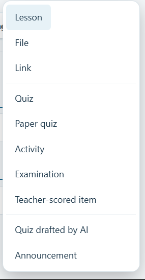

# System Integration Process Documentation - Objective 3

**Project:** LearnSync  
**Specific objective integrated:** *To implement automated and manual assessment recording sheets for minor and major assessments.*

## 1. Objective 3

To implement automated and manual assessment recording sheets for minor and major assessments.

In LearnSync, minor assessments include online quizzes, paper quizzes, activities, and teacher-evaluated work. Major assessments include examinations. The system supports both (1) automatically computed scores for online quizzes and (2) teacher-entered scores for paper-based and manually evaluated assessments.

## 2. Components/Modules Integrated

| Title | Component(s) |
| --- | --- |
| Modules | Faculty assessment; student assessment; scoring; Gradebook. |
| Features | Automatic quiz scoring; manual scoring (paper quizzes, activities, exams); result release. |
| Hardware | Faculty/student computers; application server. |
| Software | React; FastAPI. |
| API | Assessment API; quiz-attempt API; Gradebook API; result-release API. |
| Database | PostgreSQL: `assessment`, `assessment_revision`, `quiz_attempt`, `quiz_answer`, `assessment_score`, `result_publication`. |
| Other components | Authentication; role/ownership checks; score audit log. |

### Codebase basis

| Implemented component | Source evidence |
| --- | --- |
| Assessment types and database tables | `backend/app/features/assessments/models.py` defines online quiz, offline quiz, activity, examination, and manual assessment types, plus attempts, answers, scores, and result-publication records. |
| Manual score entry and validation | `backend/app/features/assessments/scores.py` validates publication, enrollment, maximum score, and concurrent edits before saving a manual score. |
| Automatic quiz scoring | `backend/app/features/assessments/attempts.py` submits an attempt and calls `sync_quiz_score`; `scores.py` selects the latest or highest submitted attempt. |
| Integrated gradebook | `backend/app/features/assessments/gradebook_edit.py` saves multiple gradebook cells atomically; `frontend/src/features/assessments/GradebookPage.tsx` displays the gradebook. |
| Faculty and student screens | `Assessments.tsx`, `ScoresPage.tsx`, `Work.tsx`, and `ResultsPage.tsx` implement the related user interfaces. |

## 3. Integration Process

1. The administrator creates the school term, subject, section, teacher assignment, and enrolled students.
2. The teacher creates or publishes a grading policy that identifies the assessment categories and their weights for the midterm and finals periods.
3. The teacher creates an assessment and selects its type:
   - **Online quiz** for automated recording;
   - **Paper quiz, examination, or teacher-evaluated assessment** for manual recording.
4. The teacher configures the assessment title, category, grading period, maximum points, applicable sections, and availability settings, then publishes it. Publishing adds the assessment to the gradebook.
5. For an **online quiz**, a student opens the quiz, submits answers, and the backend stores the attempt and answers. The scoring service computes the result from the submitted answers and updates the corresponding `assessment_score` record automatically.
6. For a **manual assessment**, the teacher opens either the assessment Scores page or Gradebook edit mode, enters each student's score and optional feedback, and saves. The API validates that the assessment is published, the student is enrolled and applicable, and the score does not exceed the configured maximum.
7. The Gradebook retrieves all recorded scores and uses the selected categories, periods, and grading policy to calculate the current standing. Online-quiz scores appear automatically; manual scores appear after the teacher saves them.
8. When grading is complete, the teacher releases individual assessment results and/or publishes period grades. Students can then view only the released result, not the teacher's working gradebook data.

### Integration flow

```text
Teacher creates & publishes assessment
              |
      +-------+--------+
      |                |
Online quiz        Manual assessment
      |                |
Student submits    Teacher enters score(s)
      |                |
Automatic scoring  Score validation and save
      +-------+--------+
              |
     AssessmentScore in PostgreSQL
              |
        Gradebook calculation
              |
      Released results / grades
```

## 4. Screenshot/Evidence

### Figure 1. Assessment type selection



This available interface screenshot shows the assessment types from which faculty can choose. It demonstrates the selection step only; it does not show a saved score or an automatically calculated quiz result.

**Additional evidence needed for a complete live demonstration:** capture the submitted online-quiz result, a saved manual score, and the same learners' records in the Gradebook. No authenticated LearnSync session was available for those captures during this documentation update, so no such screenshots are claimed here.

## 5. Testing/Result

### Expected test scenario

1. Create and publish one online quiz (for example, 10 points) and one manual examination (for example, 50 points) under the same subject and grading period.
2. Log in as a student, submit the online quiz, and verify that its score appears in the teacher's Scores page/Gradebook without manual score entry.
3. Log in as the teacher, enter examination scores for enrolled students, and save.
4. Confirm that the Gradebook shows both columns and recalculates each student’s current standing according to the grading policy.
5. Release one assessment result and verify, using the student account, that the released score is visible while unreleased working scores remain private.

### Result based on implementation and recorded checks

The code connects online-quiz submissions and faculty-entered scores to the shared assessment score records consumed by the Gradebook. The score service blocks manual entry for online quizzes, checks the configured maximum and enrollment, and uses revisions to detect stale edits. Gradebook batch editing validates all cells and saves them together or rejects the batch.

The acceptance record documents five passing gradebook-edit tests, including batch score saving, all-or-nothing rejection, score limits, role restrictions, and prevention of manual online-quiz scoring. It also documents two existing assessment score-entry expectation failures. The live browser workflow was not verified; the acceptance record notes a prior 401 response, and browser tests requiring a disposable database were not run.

**Result:** the automated and manual paths are integrated in the implementation and the recorded gradebook-edit checks passed, but complete end-to-end operation is not confirmed by the available live evidence. The two score-entry failures and missing authenticated browser verification must be resolved/verified before claiming a full integration pass. See [ACCEPTANCE.md](./ACCEPTANCE.md) for the recorded check history.

## 6. Problems and Solutions

| Problem encountered | Solution / safeguard |
| --- | --- |
| Manual scores could be entered above the assessment maximum. | The scoring service rejects a score greater than `max_points` and returns a validation error. |
| A teacher could accidentally overwrite another teacher's newer score change. | Each score has a revision number. If the submitted revision is stale, the system rejects the save and asks the user to reload. |
| A batch gradebook save could partially save data if one cell is invalid. | Gradebook edit mode validates all cells first. If any cell fails, the transaction is rolled back and no cell is saved. |
| An online quiz score could be manually changed and disagree with the student attempt. | The API disallows manual score entry for online quizzes; their score is synchronized from submitted attempts. |
| Students might see working scores before the teacher is ready. | Working scores are faculty-visible only. Students see an immutable result only after the teacher releases it. |
| Full live verification and screenshots could not be completed because there was no authenticated app session; a prior browser attempt returned 401, and browser tests require a disposable database. | Use an authorized faculty/student test account and a freshly migrated disposable test database, rerun the end-to-end workflow, and capture the online result, manual score, and combined Gradebook. The current record does not claim that verification passed. |

## Conclusion

The automated and manual assessment-recording features were integrated through a single assessment, scoring, database, and gradebook workflow. Online assessments create scores automatically from student attempts, while paper-based and teacher-evaluated assessments accept validated teacher input. Both routes produce standardized score records that feed the same gradebook and controlled result-release process.
